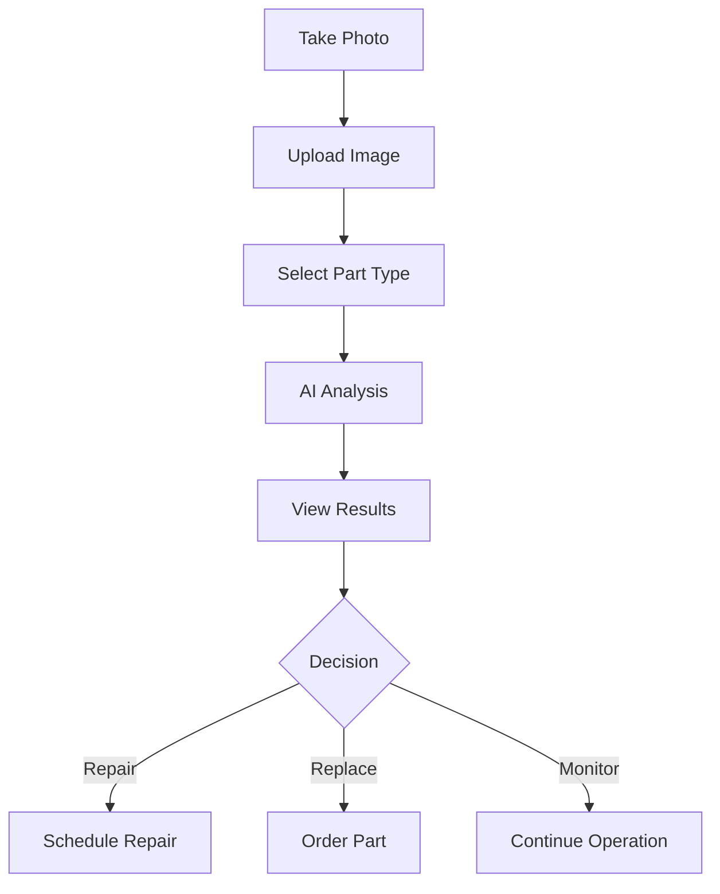

# Image-Based Damage Assessment Guide

## Overview

The Image-Based Damage Assessment feature enables real-time analysis of robot part damage through AI-powered image recognition. Upload a photo of a damaged part to receive instant recommendations on whether to repair or replace, complete with detailed cost breakdowns.

## Quick Start

### Web Interface

1. Open `frontend/damage-assessment.html` in your browser
2. Upload or drag-and-drop an image of the damaged part
3. Optionally select the part type (or let AI detect it)
4. Click "Analyze Damage"
5. Review results and recommendations

### API Endpoint

```bash
curl -X POST "http://localhost:8000/api/v1/damage-assessment/upload" \
  -F "image=@damaged_motor.jpg" \
  -F "part_type=motor_servo"
```

## Features

### ✨ Core Capabilities

- **🔍 Automatic Part Identification**: AI recognizes robot parts from images
- **🎯 Damage Detection**: Identifies cracks, dents, corrosion, wear, and more
- **📊 Severity Assessment**: Classifies damage as minor, moderate, severe, or critical
- **💰 Cost Analysis**: Compares repair vs replacement costs
- **⚠️ Safety Evaluation**: Identifies safety concerns
- **📋 Detailed Reports**: Comprehensive damage documentation
- **⏱️ Real-Time Processing**: Results in seconds
- **📱 Mobile-Friendly**: Upload images from any device

### 🔧 Supported Part Types

| Part Type | Category | Repairable | Avg Repair Cost | Avg Replace Cost |
|-----------|----------|------------|-----------------|------------------|
| **Servo Motor** | Actuator | ✅ Yes | $45 | $150 |
| **Wheel Assembly** | Mobility | ✅ Yes | $25 | $80 |
| **Camera Module** | Sensor | ✅ Yes | $60 | $200 |
| **LiDAR Sensor** | Sensor | ✅ Yes | $150 | $500 |
| **Gripper Finger** | End Effector | ✅ Yes | $35 | $120 |
| **Battery Pack** | Power | ❌ No | - | $300 |
| **Joint Bearing** | Mechanical | ✅ Yes | $20 | $60 |
| **Control Board** | Electronics | ✅ Yes | $80 | $250 |
| **Cable Harness** | Wiring | ✅ Yes | $15 | $40 |
| **Arm Link** | Structure | ✅ Yes | $55 | $180 |

### 🔎 Damage Types Detected

1. **Crack** - Linear fractures in material
2. **Dent** - Impact deformation
3. **Corrosion** - Rust or chemical damage
4. **Scratch** - Surface abrasions
5. **Wear** - Normal degradation over time
6. **Fracture** - Broken or split components
7. **Deformation** - Shape distortion
8. **Burn** - Heat or electrical damage
9. **Rust** - Metal oxidation
10. **Broken** - Complete failure
11. **Loose** - Connection issues
12. **Missing Part** - Components absent

### 📈 Severity Levels

#### 🟢 Minor
- **Definition**: Cosmetic damage, no functional impact
- **Action**: Monitor during regular maintenance
- **Estimated Life**: 6-12 months with monitoring
- **Example**: Light scratches, minor wear

#### 🟡 Moderate
- **Definition**: Noticeable damage, reduced performance
- **Action**: Schedule repair within 2-6 months
- **Estimated Life**: 2-6 months with regular inspection
- **Example**: Small cracks, moderate corrosion

#### 🟠 Severe
- **Definition**: Significant damage, compromised function
- **Action**: Repair or replace within 1 month
- **Estimated Life**: Less than 1 month - immediate action required
- **Example**: Large cracks, extensive corrosion

#### 🔴 Critical
- **Definition**: Catastrophic damage, imminent failure
- **Action**: Replace immediately
- **Estimated Life**: Immediate replacement required
- **Example**: Broken components, structural failure

## User Workflow

### Step-by-Step Process



### 1. Capture Image

**Best Practices:**
- ✅ Good lighting (natural or bright artificial)
- ✅ Clear focus on damaged area
- ✅ Multiple angles for complex damage
- ✅ Include part context (show mounting points)
- ✅ Clean part surface if possible
- ❌ Avoid blurry images
- ❌ Avoid extreme angles
- ❌ Don't include multiple parts in one image

**Image Requirements:**
- Format: JPG, PNG
- Size: Max 10MB
- Resolution: Minimum 640x480, recommended 1920x1080
- Quality: Clear, well-lit, in-focus

### 2. Upload & Analyze

**Web Interface:**
1. Open damage-assessment.html
2. Drag-and-drop or click to browse
3. Select part type (optional)
4. Enter robot model (optional)
5. Click "Analyze Damage"

**API:**
```python
import httpx

with open("damaged_part.jpg", "rb") as f:
    response = httpx.post(
        "http://localhost:8000/api/v1/damage-assessment/upload",
        files={"image": f},
        data={"part_type": "motor_servo"}
    )
    result = response.json()
```

### 3. Review Results

The assessment provides:

#### Part Information
- Part name and number
- Category
- Identification confidence
- Overall condition

#### Damage Analysis
- Number of damage regions
- Types of damage detected
- Severity levels
- Affected areas (percentage)
- Detection confidence

#### Cost Breakdown

**Repair Cost includes:**
- Parts/materials cost
- Labor cost (based on estimated hours)
- Shipping cost
- Overhead (15%)

**Replacement Cost includes:**
- New part cost
- Installation labor
- Expedited shipping
- Overhead (15%)

#### Recommendation
- **🟢 Repair**: More cost-effective, part can be restored
- **🟠 Replace**: Better value, faster turnaround
- **🔴 Urgent Replace**: Safety critical, immediate action
- **⚪ Monitor**: Continue operation with inspection

### 4. Make Decision

**Decision Factors:**

| Factor | Favor Repair | Favor Replace |
|--------|--------------|---------------|
| Cost | Repair < 70% of replacement | Repair > 70% of replacement |
| Time | Can wait days/weeks | Need quick turnaround |
| Criticality | Non-critical part | Safety-critical part |
| Warranty | Out of warranty | Under warranty |
| Downtime | Can schedule maintenance | Minimize downtime |
| Part Age | Recent part | Old/obsolete part |

## API Reference

### Upload Image for Assessment

**Endpoint:** `POST /api/v1/damage-assessment/upload`

**Request:**
```bash
curl -X POST "http://localhost:8000/api/v1/damage-assessment/upload" \
  -F "image=@robot_part.jpg" \
  -F "part_type=motor_servo" \
  -F "robot_model=RoboArm-X1"
```

**Parameters:**
- `image` (file, required): Robot part image
- `part_type` (string, optional): Part type identifier
- `robot_model` (string, optional): Robot model name

**Response:**
```json
{
  "assessment_id": "ASSESS-20261016120000-1234",
  "timestamp": "2026-10-16T12:00:00Z",
  "part_info": {
    "part_name": "Servo Motor",
    "part_number": "MOTOR_SERVO",
    "category": "Actuator",
    "confidence": 0.95
  },
  "damage_regions": [
    {
      "damage_type": "crack",
      "severity": "moderate",
      "bbox": [100, 150, 80, 120],
      "confidence": 0.75,
      "area_percentage": 3.5,
      "description": "Crack detected in Servo Motor"
    }
  ],
  "overall_severity": "moderate",
  "condition": "fair",
  "recommendation": "repair",
  "repair_cost": {
    "parts_cost": 45.00,
    "labor_cost": 60.00,
    "shipping_cost": 15.00,
    "overhead_cost": 18.00,
    "total_cost": 138.00,
    "currency": "USD",
    "estimated_time_hours": 0.8
  },
  "replacement_cost": {
    "parts_cost": 150.00,
    "labor_cost": 37.50,
    "shipping_cost": 45.00,
    "overhead_cost": 34.88,
    "total_cost": 267.38,
    "currency": "USD",
    "estimated_time_hours": 0.5
  },
  "recommended_action": "🟢 RECOMMEND REPAIR: Cost $138.00, Time: 0.8h (Save $129.38 vs replacement)",
  "detailed_findings": [
    "Part identified: Servo Motor (Actuator)",
    "Total damage regions detected: 1",
    "Region 1: Crack - Moderate severity (3.5% affected, 75% confidence)"
  ],
  "safety_concerns": [
    "⚠️ Servo Motor is a critical safety component",
    "✓ No immediate safety concerns identified"
  ],
  "estimated_remaining_life": "2-6 months with regular inspection",
  "confidence_score": 0.89,
  "image_quality": "good"
}
```

### Get Available Parts

**Endpoint:** `GET /api/v1/damage-assessment/parts`

**Response:**
```json
{
  "parts": [
    {
      "id": "motor_servo",
      "name": "Servo Motor",
      "category": "Actuator",
      "avg_repair_cost": 45.00,
      "avg_replacement_cost": 150.00,
      "is_critical": true,
      "repairable": true
    }
  ]
}
```

### Get Cost Estimate

**Endpoint:** `GET /api/v1/damage-assessment/cost-estimate/{part_type}`

**Parameters:**
- `part_type`: Part identifier (e.g., motor_servo)
- `severity`: Damage severity (minor, moderate, severe, critical)

**Response:**
```json
{
  "part_name": "Servo Motor",
  "severity": "moderate",
  "repair_cost": {
    "total": 138.00,
    "time_hours": 0.8
  },
  "replacement_cost": {
    "total": 267.38,
    "time_hours": 0.5
  },
  "recommendation": "repair",
  "cost_savings": 129.38
}
```

## Examples

### Example 1: Web Interface Upload

```html
<!-- Open frontend/damage-assessment.html -->
<!-- Upload image via drag-and-drop or file picker -->
<!-- View instant results -->
```

### Example 2: Python Script

```python
import httpx
import asyncio

async def assess_damage(image_path, part_type=None):
    with open(image_path, 'rb') as f:
        files = {'image': f}
        data = {'part_type': part_type} if part_type else {}
        
        async with httpx.AsyncClient() as client:
            response = await client.post(
                'http://localhost:8000/api/v1/damage-assessment/upload',
                files=files,
                data=data,
                timeout=60.0
            )
            return response.json()

# Usage
result = asyncio.run(assess_damage('damaged_motor.jpg', 'motor_servo'))
print(f"Recommendation: {result['recommended_action']}")
print(f"Repair Cost: ${result['repair_cost']['total_cost']:.2f}")
print(f"Replace Cost: ${result['replacement_cost']['total_cost']:.2f}")
```

### Example 3: Batch Processing

```python
import asyncio
from pathlib import Path

async def batch_assess(image_folder):
    results = []
    for image_path in Path(image_folder).glob('*.jpg'):
        result = await assess_damage(str(image_path))
        results.append(result)
    return results

# Process all images in folder
results = asyncio.run(batch_assess('./damaged_parts'))

# Generate report
total_repair = sum(r['repair_cost']['total_cost'] for r in results if r['repair_cost'])
total_replace = sum(r['replacement_cost']['total_cost'] for r in results)

print(f"Total parts assessed: {len(results)}")
print(f"Total repair cost: ${total_repair:.2f}")
print(f"Total replacement cost: ${total_replace:.2f}")
print(f"Savings: ${total_replace - total_repair:.2f}")
```

## Cost Calculation Details

### Repair Cost Formula

```
Base Cost = Part's Average Repair Cost × Severity Multiplier

Severity Multipliers:
- Minor: 0.8×
- Moderate: 1.0×
- Severe: 1.5×
- Critical: 2.0×

Labor Cost = Estimated Hours × $75/hour
Estimated Hours = 1.0 + (0.5 × Number of Damage Regions)

Shipping = $15 (standard)
Overhead = (Base + Labor + Shipping) × 15%

Total = Base + Labor + Shipping + Overhead
```

### Replacement Cost Formula

```
Parts Cost = Part's Average Replacement Cost
Labor Cost = 0.5 hours × $75/hour
Shipping = $45 (expedited)
Overhead = (Parts + Labor + Shipping) × 15%

Total = Parts + Labor + Shipping + Overhead
```

## Troubleshooting

### Poor Image Quality

**Problem:** Low confidence scores or incorrect detection

**Solutions:**
- Retake image with better lighting
- Clean part before photographing
- Use higher resolution camera
- Get closer to damaged area
- Try multiple angles

### Part Not Recognized

**Problem:** AI cannot identify part

**Solutions:**
- Manually select part type from dropdown
- Ensure entire part is visible
- Remove obstructions
- Check if part type is supported
- Contact support for new part types

### Unexpected Costs

**Problem:** Cost estimates seem too high/low

**Solutions:**
- Verify part type selection is correct
- Check if damage severity seems accurate
- Compare with manual inspection
- Cost estimates are averages - actual may vary
- Contact support for custom pricing

### API Errors

**Problem:** Upload fails or returns errors

**Solutions:**
- Check image file size (max 10MB)
- Verify image format (JPG/PNG only)
- Ensure API server is running
- Check network connection
- Review API documentation

## Best Practices

### 1. Regular Inspections

- Schedule periodic part inspections
- Document all assessments
- Track damage progression over time
- Build historical data for predictive maintenance

### 2. Cost Optimization

- Batch assess multiple parts together
- Compare quotes from multiple vendors
- Consider refurbished parts
- Negotiate volume discounts
- Plan repairs during scheduled downtime

### 3. Safety First

- Always prioritize safety over cost
- Replace critical parts promptly
- Don't delay on severe/critical damage
- Follow manufacturer recommendations
- Document all safety-related decisions

### 4. Documentation

- Save all assessment reports
- Keep images organized by robot/date
- Track repair history
- Monitor part lifespans
- Share data across maintenance teams

## Integration

### With Maintenance Systems

```python
# Example: Auto-create work order
if result['recommendation'] in ['replace', 'urgent_replace']:
    create_work_order(
        robot_id=robot_id,
        part=result['part_info']['part_name'],
        priority='high',
        estimated_cost=result['replacement_cost']['total_cost']
    )
```

### With Inventory Systems

```python
# Example: Check part availability
if result['recommendation'] == 'replace':
    part_number = result['part_info']['part_number']
    if not in_stock(part_number):
        order_part(part_number, quantity=1, priority='expedited')
```

### With Alerts

```python
# Example: Send alert for critical damage
if result['overall_severity'] == 'critical':
    send_alert(
        recipient='maintenance@company.com',
        subject=f"CRITICAL: {result['part_info']['part_name']} Failure",
        body=result['recommended_action']
    )
```

## FAQ

**Q: How accurate is the damage detection?**  
A: Typical confidence scores range from 70-95%. Higher quality images yield better accuracy.

**Q: Can I upload images from my phone?**  
A: Yes! The web interface is mobile-friendly. Just access the URL on your phone.

**Q: Are costs region-specific?**  
A: Currently costs are in USD. Contact support for region-specific pricing.

**Q: What if my part isn't in the list?**  
A: You can still upload and get damage analysis. Contact support to add new parts.

**Q: Can I get a second opinion?**  
A: Yes, you can upload the same image multiple times or have a human expert review.

**Q: How long are assessments stored?**  
A: Assessment IDs and results are stored for 90 days by default.

**Q: Can I export reports?**  
A: Yes, use the API response as JSON or integrate with your reporting system.

## Support

- **Documentation**: `/docs/DAMAGE_ASSESSMENT_GUIDE.md`
- **API Reference**: `http://localhost:8000/docs`
- **Examples**: `/examples/damage_assessment_example.py`
- **Web Interface**: `/frontend/damage-assessment.html`
- **Issues**: GitHub Issues
- **Email**: support@robotics-platform.com

---

**Version**: 1.0.0  
**Last Updated**: October 2026  
**Platform**: Physical AI Robotics Platform v2.7
